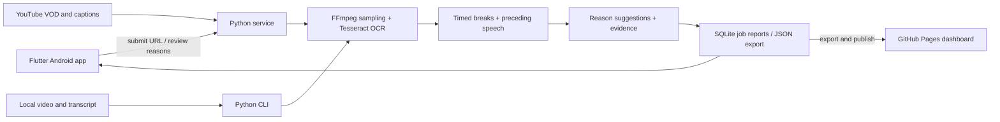

# BRB Tracker

An Android-first tool for finding **“Be Right Back”** screens in Gamin4Hope’s YouTube VODs, estimating their duration, and suggesting a reason from the preceding transcript. Includes a Flutter Android app, a Python analysis service/CLI, and a static dashboard ready for GitHub Pages.

**Status: working prototype.** Local video → OCR → timed breaks → transcript suggestions → JSON is implemented and tested with a generated video. The Android client supports submitting YouTube VODs, polling jobs, reading reports, correcting reasons, opening YouTube timestamps, and copying report JSON. Real Gamin4Hope VOD detection still needs calibration: the development environment returned HTTP 403 for the example VOD. Bundled sample data is invented, not measured streamer activity.

## How it fits together



Video processing runs on your computer/server, **not on the phone**. The Android app is the primary interface. Flutter lets us add desktop targets later. GitHub Pages only serves exported results; it cannot run the analyzer. There is no paid AI service or cloud account requirement for the analysis.

## Run the analyzer

Requires Python 3.11+, FFmpeg/ffprobe, and Tesseract with English language data. On Ubuntu/Debian:

```sh
sudo apt-get install ffmpeg tesseract-ocr fonts-dejavu-core
python -m venv .venv
. .venv/bin/activate
python -m pip install -e '.[dev]'
```

Analyze the example VOD:

```sh
brb-tracker analyze \
  --url 'https://www.youtube.com/live/IW2rEIuKGSs' \
  --output data/gamin4hope-report.json
```

YouTube availability, captions, rate limits and extractor changes can prevent URL input from working. Keep yt-dlp current (`python -m pip install -U 'yt-dlp[default]'`) and install a [supported JavaScript runtime](https://github.com/yt-dlp/yt-dlp#dependencies), such as Deno, if the extractor requires it. The prototype does not handle sign-in/cookies or bypass restricted videos. Use local video files you are allowed to process as a fallback:

```sh
brb-tracker analyze --video /path/to/vod.mp4 \
  --transcript /path/to/transcript.json \
  --title 'Gamin4Hope VOD' --output data/report.json
```

Accepted transcripts: YouTube `.json3`, `.vtt`, or JSON cues with video-relative seconds:

```json
[
  {"start": 120.0, "end": 124.5, "text": "I need to grab a snack. Be right back."}
]
```

If captions are absent, breaks are still detected with **Unknown** reasons. Optional local transcription is available in the CLI:

```sh
python -m pip install -e '.[transcribe]'
brb-tracker analyze --video vod.mp4 --whisper --output data/report.json
```

This downloads a `base.en` speech model on first use and may take considerable CPU time. API jobs currently use available English YouTube captions, without automatic Whisper fallback.

## Android app

Use Flutter **3.50.0 stable**, Android SDK/Android Studio, and Java 17. CI builds a sideloadable **debug APK** under **Actions → Checks and Android APK → Artifacts** after successful checks. It is a development build, not a Play Store release.

Start the service on the computer running your Android emulator:

```sh
export BRB_API_TOKEN="$(python -c 'import secrets; print(secrets.token_urlsafe(32))')"
# Keep the token on your computer; enter it in the app, not in Git.
brb-tracker serve --host 0.0.0.0 --port 8000 --data-dir data
```

Then:

```sh
cd apps/mobile
flutter pub get
flutter run
```

1. Tap **Explore sample report** to try the app without a service.
2. Enter `http://10.0.2.2:8000` for the standard Android emulator, or the computer’s LAN address for a physical phone, and your API token.
3. Tap **Connect**, then **Analyze VOD**. The service must keep running; downloading may show 0% until OCR begins. Long VODs can take a long time and several GB of temporary disk space.
4. Open a completed analysis, inspect the evidence, and change reasons with the dropdown. Corrections persist in SQLite and retain the original suggested reason.
5. Tap the copy icon on a report, then paste its JSON into the dashboard’s **Import report** dialog.

Local HTTP is enabled only for debug APKs. Release builds require an HTTPS service. For internet access, use HTTPS through a reverse proxy and set `BRB_API_TOKEN`. The service refuses a non-loopback bind without that token. Tokens stay in app memory for the current session; connection settings are re-entered after restarting the app.

API documentation is available at `http://127.0.0.1:8000/docs`. Protected endpoints require `Authorization: Bearer <token>`:

| Endpoint | Purpose |
| --- | --- |
| `GET /health` | Service status, no token required |
| `POST /jobs` | Submit `{"url":"https://www.youtube.com/watch?v=…"}` |
| `GET /jobs` | Latest 100 jobs and progress |
| `GET /jobs/{id}` | Status and completed report |
| `PATCH /jobs/{id}/breaks/{index}` | Save `{"reason":"Snack"}`; index starts at zero |
| `GET /reports` | Export all completed reports |

The service is a single-user prototype with one worker and at most eight queued/running jobs. Run only one service process per data directory. Completed reports survive restarts; interrupted or queued jobs become failed and must be resubmitted. Downloaded video and captions are removed after each job. No unattended scanning or recurring downloads are enabled.

## Dashboard and GitHub Pages

```sh
# A report file, several report files, or completed API jobs:
brb-tracker export data/report.json --output docs/data/reports.json
brb-tracker export --data-dir data --output docs/data/reports.json
python -m http.server 8080 --directory docs
```

Open `http://localhost:8080`. The dashboard shows total time away, break count, average/longest break, most common reason (including ties), reason distribution, per-VOD timelines, timestamps and transcript evidence. Filter by VOD and reason; import JSON from a file or the app clipboard. Imports replace the view locally, without uploading or saving it. Reloading restores the published dataset. Export JSON downloads the full loaded dataset, regardless of filters. Export deduplicates repeated analyses by YouTube video ID; imports reject duplicate VODs to avoid inflated totals.

To publish on GitHub:

1. In repository **Settings → Pages**, select **GitHub Actions** as the build source.
2. Run **Actions → Publish dashboard → Run workflow**.
3. After changing `docs/data/reports.json`, commit/push and run the workflow again.

The intended URL is `https://mactimit.github.io/brb-tracker/` after successful publication. The repository was created as public by its owner. **A private repository needs a GitHub plan that supports Pages for private repositories.** Pages visibility is controlled separately from repository visibility; inspect the Pages settings before publishing real transcript excerpts. The workflow is manual so reports are only published intentionally.

## Detection and interpretation

- Default: sample a frame every **2 seconds**, scale to at most 960 pixels wide, and OCR English text with Tesseract. A match requires the normalized words `be right back`; `BRB` is not enabled by default. Override with `--phrase 'brb'` for a known screen design.
- Two consecutive positive samples confirm a break. Two negative samples confirm its end; a single missing OCR match is tolerated. Timing uses the first positive sample and first negative sample in a confirmed run. An active screen at EOF is marked `truncated` and its observed duration ends at the video boundary.
- Sampling alone introduces up to about one interval of uncertainty at each boundary. OCR errors, transitions and tolerated gaps can add more error. Very brief screens can be missed. A small “be right back” chat message or overlay can create a false positive; full-frame OCR needs validation against the real BRB screen before trusting totals.
- Reasons use the last **five complete transcript cues within 60 seconds before the detected start**. A cue crossing the detected start is excluded. `--lookback`, `--interval`, `--min-hits` and `--end-misses` can be adjusted in the CLI.
- Categories: **Pee, Snack, Drink, Stretch, Technical, Other, Unknown**. Rules look for first-person/intent language and keywords, skip negated announcements, and leave mixed or missing evidence Unknown. These are suggestions, not verified facts or calibrated probabilities. Other is available as a manual correction.
- A BRB screen measures screen display time; it cannot prove when someone physically left or returned. Review the timestamps and evidence before publishing conclusions.

## Verification

```sh
pytest -q
npm ci && npm test
node --check docs/app.js
cd apps/mobile
flutter analyze
flutter test
flutter build apk --debug
```

The Python tests cover OCR phrase normalization, debounce/dropouts, separate breaks, EOF truncation, negative/ambiguous reasons, excluding future transcript cues, subtitle parsing, source URL validation, authentication, durable corrections and queue behavior. The integration test generates a real 24-second video, runs FFmpeg/Tesseract, and verifies two timed breaks and their transcript-derived reasons. Flutter tests cover the offline report, duration formatting and API authentication failures. Dashboard DOM tests cover aggregates, filters, empty reports, safe imports, duplicate rejection, ties and timestamp links. Visual browser verification and physical-device testing are separate from these checks.

## Next milestones

- Calibrate against the actual Gamin4Hope BRB screen; add a configurable crop/template and inspect real false positives/negatives.
- Add boundary editing, job cancellation, cached media and incremental/resumable scans.
- Add a transcript/ASR picker and per-job detector settings in the Android app.
- Persist app connection settings securely, add file-based report sharing/import, and test on a physical Android device.
- Add signed release builds and a Play Store distribution flow.
- Add Windows/Linux/macOS Flutter targets after Android validation; on-device analysis is a separate future option.

Example source supplied by the user: https://www.youtube.com/live/IW2rEIuKGSs. No affiliation with or endorsement by Gamin4Hope is implied.
