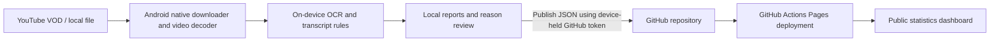

# BRB Tracker

**[Download Android v0.2.1 preview](https://github.com/MacTimiT/brb-tracker/releases/download/v0.2.1-preview/brb-tracker-0.2.1-android.apk)** · [Release notes](https://github.com/MacTimiT/brb-tracker/releases/tag/v0.2.1-preview)

An Android-first tool for locally finding **“Be Right Back”** screens in Gamin4Hope’s YouTube VODs, estimating their duration, and suggesting a reason from the preceding transcript. Includes a Flutter Android app, a Python analysis service/CLI, and a static dashboard ready for GitHub Pages.

**Status: on-device Android prototype.** Android now includes native VOD downloading, video decoding, OCR, break timing, transcript classification, local corrections and direct GitHub publication. CI builds the APK and runs native unit tests plus an Android emulator test using generated footage. The example Gamin4Hope VOD still needs a real-network/device validation: development access returned HTTP 403. Bundled dashboard sample statistics are invented, not measured activity.

## How it fits together



Video processing runs on the phone. GitHub only stores reports and builds the static website. The Python CLI/service remains an optional alternative for development and future desktop workflows. Flutter provides a reusable UI; the new local processing bridge is Android-specific.

## Run the analyzer

Requires Python 3.11+, FFmpeg/ffprobe, and Tesseract with English language data. On Ubuntu/Debian:

```sh
sudo apt-get install ffmpeg tesseract-ocr fonts-dejavu-core
python -m venv .venv
. .venv/bin/activate
python -m pip install -e '.[dev]'
```

Analyze the example VOD:

```sh
brb-tracker analyze \
  --url 'https://www.youtube.com/live/IW2rEIuKGSs' \
  --output data/gamin4hope-report.json
```

YouTube availability, captions, rate limits and extractor changes can prevent URL input from working. Keep yt-dlp current (`python -m pip install -U 'yt-dlp[default]'`) and install a [supported JavaScript runtime](https://github.com/yt-dlp/yt-dlp#dependencies), such as Deno, if the extractor requires it. The prototype does not handle sign-in/cookies or bypass restricted videos. Use local video files you are allowed to process as a fallback:

```sh
brb-tracker analyze --video /path/to/vod.mp4 \
  --transcript /path/to/transcript.json \
  --title 'Gamin4Hope VOD' --output data/report.json
```

Accepted transcripts: YouTube `.json3`, `.vtt`, or JSON cues with video-relative seconds:

```json
[
  {"start": 120.0, "end": 124.5, "text": "I need to grab a snack. Be right back."}
]
```

If captions are absent, breaks are still detected with **Unknown** reasons. Optional local transcription is available in the CLI:

```sh
python -m pip install -e '.[transcribe]'
brb-tracker analyze --video vod.mp4 --whisper --output data/report.json
```

This downloads a `base.en` speech model on first use and may take considerable CPU time. API jobs currently use available English YouTube captions, without automatic Whisper fallback.

## Android app: no PC or server required

Version **0.2.1** parses video on Android and adds a Gamin4Hope banner profile calibrated against the supplied reference. The phone downloads a low-resolution MP4 and available English captions with a bundled yt-dlp/Python/QuickJS runtime, samples video using Android's media decoder, runs bundled English Tesseract OCR, detects/times BRB screens, and categorizes the preceding transcript locally. The Python service is now optional and is not used by the app.

Use Android **8.0+ (API 26)** on a **64-bit ARM phone**; x86_64 is also built for emulator testing. CI creates a sideloadable development APK under **Actions → Checks and Android APK → Artifacts → brb-tracker-android-local-debug**. This is a debug build, not a Play Store release. CI development signing keys are not stable between runs: if Android rejects an update because signatures differ, uninstall the previous debug app before installing. Uninstalling deletes its local reports and saved token; publish or copy any reports you want to keep first.

### Use only your phone

1. Enter the YouTube VOD URL and tap **Analyze locally**. Use Wi-Fi and a charger. The first run initializes the native downloader/OCR runtime. The app attempts to update yt-dlp before downloading, falling back to the bundled version if the update fails.
2. Alternatively, choose an MP4 already on the phone. You can attach a `.json`, `.json3`, or `.vtt` transcript using the document picker. For local videos, add the matching YouTube source URL if you want timestamp links.
3. A foreground notification shows progress and has a Cancel action. Downloads and scanning run on the phone, even when you leave the screen, subject to Android's background limits. The app can process one VOD at a time.
4. Open the completed report, inspect transcript evidence and correct reasons with the dropdown. Reports and corrections persist in app-private storage. The downloaded video/captions are deleted after completion, cancellation or failure; imported original files remain where you selected them.
5. Configure GitHub publishing once, then tap **Publish to GitHub dashboard** in the completed report. That uploads only JSON, never the VOD, screenshots or credentials. Review the public transcript excerpts before publishing.

No speech-to-text model is bundled on Android yet. If captions are unavailable and you do not import a transcript, screen timing still works and reasons stay **Unknown** until corrected manually. YouTube may block downloads or require authentication; the app does not bypass restricted videos. Local-file analysis remains available.

### Connect GitHub from the phone

Open the cloud/upload icon in the app. Set owner `MacTimiT`, repository `brb-tracker`, and a **fine-grained personal access token** restricted to this repository with **Contents: read and write**. Metadata read access is included automatically. Create the token through GitHub's settings in your phone browser and paste it into the app, never into a chat or Git. It is stored using Android secure storage; use **Forget saved token** to remove it.

Publishing reads the existing `docs/data/reports.json`, keeps other real VODs, replaces any previous report for the same YouTube video ID, removes invented demo reports, and commits the merged file. Conflicts trigger a fresh read and retry so concurrent reports are not silently lost. The Pages workflow runs automatically when `docs/**` changes on `main`. GitHub builds the static page, usually within a minute or two; no PC or hosted analysis service is involved. Data-only publishing does not rebuild the APK.

Reports are not automatically uploaded after analysis: publication is an explicit action. Deleting a local job does not delete an already published GitHub report.

### Build or test the Android client

For development only: Flutter **3.50.0 stable**, Android SDK and Java 17.

```sh
cd apps/mobile
flutter pub get
flutter analyze
flutter test
flutter build apk --debug
cd android
./gradlew :app:testDebugUnitTest
./gradlew :app:connectedDebugAndroidTest
```

The Android client is GPL-3.0 because it incorporates the GPL-3.0 native downloader. See [Android dependency notices](apps/mobile/THIRD_PARTY_NOTICES.md) and [license](apps/mobile/LICENSE). OCR language data is bundled, so analyzing imported video with a transcript does not require network access. Network access is used for YouTube downloads/extractor updates and when you publish to GitHub.

### Gamin4Hope banner detection

The Android default is **Gamin4Hope banner**: it looks for the red “Be Right Back” lettering in the lower-left area and excludes the right-hand chat column. It crops the decoded frame to x=5–68%, y=68–100%, normalizes that region to 960 pixels wide, isolates red lettering, and runs OCR on the resulting black-on-white text. A region without enough red pixels is rejected before OCR. Lighting, faces, the microphone and chat content are not used as break reasons.

The supplied reference screenshot was recognized at frame widths of **1280, 960, 480 and 360 pixels** using this profile. This validates that single visual reference, not detection accuracy across a full VOD. Automated fixtures are generated images: tests include a red lower-left banner and the same words appearing only in the chat column. The uploaded reference screenshot is not a repository fixture.

Choose **Full frame · other layouts** if the banner moves or changes color. That mode retains generic whole-frame OCR. Reports retain `detector_profile` so their detection settings remain visible in exports. The optional Python CLI keeps its full-frame default and supports the calibrated profile with `--profile gamin4hope`.

Reason suggestions continue to use the preceding streamer transcript. Chat messages mentioning food, drinks or bathroom breaks are not transcript evidence.

### Processing limits

Long VODs can take a long time, heat the phone and consume substantial battery/storage. Downloads use MP4 at up to 480p, require at least 1 GB free before starting and reject a single file larger than 4 GB; some downloads can still exhaust free space. The 2-second default sampling interval is adjustable to 5 or 10 seconds for speed, with lower timing precision and more missed short screens.

Android can kill the app or impose foreground-service time limits (including six-hour limits on recent Android versions). The service stops on timeout, cancellation and errors. An interrupted job is marked failed when the app reopens and must be started again; scans are not resumable yet. Keep the app available and analyze shorter files if necessary. Reports are stored privately and excluded from Android backup, and the GitHub token is never included in report JSON.

### Optional Python service

The original service remains available for desktop/development workflows, but is not required by the Android app:

```sh
export BRB_API_TOKEN="$(python -c 'import secrets; print(secrets.token_urlsafe(32))')"
brb-tracker serve --host 0.0.0.0 --port 8000 --data-dir data
```

The service has authenticated job submission/status/reason-review endpoints and API docs at `/docs`. It keeps completed reports in SQLite, processes one job at a time, bounds the queue to eight active jobs, and marks interrupted jobs failed after a restart. Use one process per data directory, HTTPS for remote access, and never commit the token.

## Dashboard and GitHub Pages

```sh
# A report file, several report files, or completed API jobs:
brb-tracker export data/report.json --output docs/data/reports.json
brb-tracker export --data-dir data --output docs/data/reports.json
python -m http.server 8080 --directory docs
```

Open `http://localhost:8080`. The GONE4HOPE dashboard shows total time away, break count, average and median duration, breaks per stream hour, count/time reason rankings, break-length distributions, stream-quarter patterns, longest/shortest breaks, uninterrupted stretches and per-VOD BRB-percentage rankings. Timelines and searchable receipts open transcript quotes and YouTube timestamps. CSV exports the filtered receipt list; JSON exports the active dataset. The default board uses published real reports; invented demo data is available only through an explicit demo control. Filter by VOD and reason; import JSON from a file or the app clipboard. Imports replace the view locally, without uploading or saving it. Reloading restores the published dataset. Export JSON downloads the full loaded dataset, regardless of filters. Export deduplicates repeated analyses by YouTube video ID; imports reject duplicate VODs to avoid inflated totals.

To publish on GitHub:

1. In repository **Settings → Pages**, select **GitHub Actions** as the build source.
2. Run **Actions → Publish dashboard → Run workflow** once, or push a change under `docs/`.
3. Publishing a report from the Android app updates the JSON and triggers deployment automatically.

The intended URL is `https://mactimit.github.io/brb-tracker/` after successful publication. The repository was created as public by its owner. **A private repository needs a GitHub plan that supports Pages for private repositories.** Pages visibility is controlled separately from repository visibility; inspect the Pages settings before publishing real transcript excerpts. The workflow runs on dashboard changes; report upload from the app is explicit.

## Detection and interpretation

- Default: sample a frame every **2 seconds**, scale to at most 960 pixels wide, and OCR English text with bundled Tesseract on Android (FFmpeg/Tesseract in the optional Python CLI). A match requires the normalized words `be right back`; `BRB` is not enabled by default. Override with `--phrase 'brb'` for a known screen design.
- Two consecutive positive samples confirm a break. Two negative samples confirm its end; a single missing OCR match is tolerated. Timing uses the first positive sample and first negative sample in a confirmed run. An active screen at EOF is marked `truncated` and its observed duration ends at the video boundary.
- Sampling alone introduces up to about one interval of uncertainty at each boundary. OCR errors, transitions and tolerated gaps can add more error. Very brief screens can be missed. A small “be right back” chat message or overlay can create a false positive; full-frame OCR needs validation against the real BRB screen before trusting totals.
- Reasons use the last **five complete transcript cues within 60 seconds before the detected start**. A cue crossing the detected start is excluded. `--lookback`, `--interval`, `--min-hits` and `--end-misses` can be adjusted in the CLI.
- Categories: **Pee, Snack, Drink, Stretch, Technical, Other, Unknown**. Rules look for first-person/intent language and keywords, skip negated announcements, and leave mixed or missing evidence Unknown. These are suggestions, not verified facts or calibrated probabilities. Other is available as a manual correction.
- A BRB screen measures screen display time; it cannot prove when someone physically left or returned. Review the timestamps and evidence before publishing conclusions.

## Verification

```sh
pytest -q
npm ci && npm test
node --check docs/app.js
cd apps/mobile
flutter analyze
flutter test
flutter build apk --debug
```

The Python tests cover OCR phrase normalization, debounce/dropouts, separate breaks, EOF truncation, negative/ambiguous reasons, excluding future transcript cues, subtitle parsing, source URL validation, authentication, durable corrections and queue behavior. The integration test generates a real 24-second video, runs FFmpeg/Tesseract, and verifies two timed breaks and their transcript-derived reasons. Flutter tests cover the offline report, Android processing dispatch, duration formatting, GitHub dataset merging, token failures, invalid remote files and conflict retries. Native Kotlin tests cover timing/classification/captions/URLs. Android emulator tests execute the bundled downloader and run a generated video through the actual foreground service, Android decoder, OCR and durable corrections without a server. Dashboard DOM tests cover aggregates, filters, empty reports, safe imports, duplicate rejection, ties and timestamp links. Visual browser verification and physical-device testing are separate from these checks.

## Next milestones

- Calibrate against the actual Gamin4Hope BRB screen; add a configurable crop/template and inspect real false positives/negatives.
- Add boundary editing, cached media and incremental/resumable scans. Cancellation is supported on Android.
- Add local speech transcription for VODs without captions and a BRB screen crop/template picker.
- Test the entire YouTube-to-GitHub flow on a physical Android phone and add file-based report sharing.
- Add signed release builds and a Play Store distribution flow.
- Add Windows/Linux/macOS Flutter targets and a corresponding local-processing bridge after Android validation.

Example source supplied by the user: https://www.youtube.com/live/IW2rEIuKGSs. No affiliation with or endorsement by Gamin4Hope is implied.
